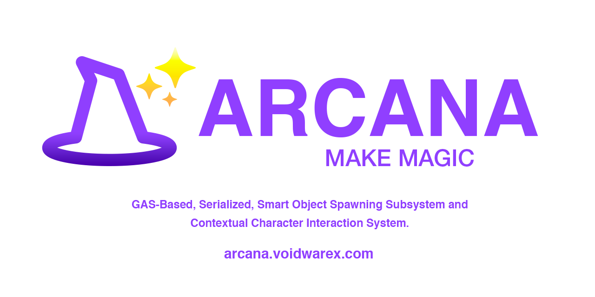

<p align="center">

</p>
<p align="center">
     &nbsp;
     <a href="https://github.com/Voidware-Prohibited/Arcana/commits/master"></a>
</p>
<!--<p align="center">
     <a href="https://github.com/Voidware-Prohibited/Arcana/commits/master"></a>&nbsp;
     <a href="https://github.com/Voidware-Prohibited/Arcana/commits/master"></a>&nbsp;
     <a href="https://github.com/Voidware-Prohibited/Arcana/commits/master"></a>&nbsp;
</p>-->
<p align="center">
     <a href="https://github.com/Voidware-Prohibited/Arcana/issues"></a>&nbsp;
     <a href="https://github.com/Voidware-Prohibited/Arcana/pulls"></a>&nbsp;
     <a href="https://github.com/Voidware-Prohibited/Arcana/blob/master/LICENSE"></a>
</p>
<p align="center">
     <a href="https://github.com/sponsors/colorindarkness"></a>&nbsp;
     <a href="https://www.patreon.com/colorindarkness"></a>&nbsp;
     <a href="https://ko-fi.com/colorindarkness"></a>&nbsp;
     <a href="https://liberapay.com/colorindarkness"></a>
</p>

> [!NOTE]  Following the acquisition of GitHub by Microsoft, VOIDWARE Prohibited has taken the principled acion and have begun primarily hosting our code and content on Codeberg. Mirrors will still be maintained on GitHub and GitLab.

A multiplayer Character Interaction System utilizing Gameplay Ability System (GAS), Contextual Animation . Arcana provides a feature rich, multiplayer-ready, cinematic, extensible Character Interaction system for modern games.

Arcana is a part of the [Target Vector](/Voidware-Prohibited/TargetVector/) framework.

[🌐Site](https://Arcana.voidwarex.com/) • [📚Wiki](../../wiki/) • [📘Documentation](https://Arcana.voidwarex.com/docs/) • [📑Roadmap](https://Arcana.notion.site/2be59e501e7a4bf583437d1636bc7f2f?v=ac361eb5a6a14081892ff9a68e3e7a44/) • [🐤Twitter](https://x.com/Arcana/) • [🗨️Discord](discord://colorindarkness/)

# Introduction
Granular control over Player and AI Interaction with Gameplay Abilities and Volumes.

> [!WARNING]  _Arcana is under heavy development, many features may not be finished or production-ready. Use at your own risk._ 

# Features
- Arcana World Subsystem.
- Interaction Gameplay Abilities.
- Contextual Animation Integration.
- Arcana World Actor Base class.
- Arcana World Actor Interface.
- Arcana World Volume Base class.
- Arcana World Volume Interface.

## Demo Content
- Demo Player Character.

# Installation

## Fab Plugin Installation
_Not available on Fab. Please perform Manual Installation_

## Manual Installation

### Latest Release
_No Releases yet. Plesae Compile From Source Code_

1. Install and setup all [Dependencies](#dependencies) (if required).
2. Download the [Latest Release](/../releases/latest).
3. Unzip to your project `Plugins` folder.
4. (Re)Start Unreal Engine Editor.

### Compile From Source Code
Your host machine must fulfill additional System Requirements to compile this project from source.

#### Compiliation System Requirements

- A working UE5 C++ Integrated Developement Environment(IDE)
     - Tested: Jetbrains Rider, VS Code, Visual Studio (Windows)
     - Untested: XCode (MacOS), Jetbrains Rider, VS Code, Visual Studio (Linux)
- clang -20 13.0.1

#### Quick Installation

1. Install and setup all [Compiliation System Requirements](#compiliation-system-requirements).
1. Install and setup all [Dependencies](#dependencies) (if required).
2. Clone/download Arcana into your projects Plugin folder.
3. (Re)Build Plugin with the `BuildPlugin.bat` Script or (Re)Build Project normally with your IDE.
4. Once compilation is successful you can now begin using Arcana in your project

[View All Available Scripts](#available-scripts)

#### Full Installation
[Full Installation Instructions](../..//wiki/Installation/) are available in the [Arcana Wiki](../..//wiki/Installation/)
Full Installation instructions available in [Arcana Documentation - Full Installation](https://Arcana.voidwarex.com/docs/Installation)

# Getting Started
To view a working demonstration, load and play the `L_Arcana` level in the `/Levels` folder. The Demo Widget will allow you to adjust parameters in Realtime.

TDB

The full [Getting Started guide](../..//wiki/GettingStarted/) is available in the [Arcana Wiki](../..//wiki/GettingStarted/)

**Content Overview**
```
(root)/                                # Demo Game Mode and Game State
├──AbilitySystem/ 
    ├── GameplayAbilities/ 
├──Actors/ 
    ├── ArcanaLevelActor               # Arcana Level Actor.
├──Characters/                         # Demo ArcanaCharacter Class.
    ├── Input                          # ArcanaCharacter Input.
├──Data/                               
    ├── ArcanaVirtualizedSpawnTypes    # Arcana Virtualized Spawn Types.
├──Interfaces/ 
    ├── ArcanaWorldActorInterface      # World Actor Interface.
├──StateTree/ 
├──Subsystems/ 
    ├── ArcanaWorldSubsystem           # World Subsystem.
├──Settings/
├──Levels/                             # Demo Level(s).
├──Utility/                            # Log.
```


# Settings
For detailed descriptions all Settings, please consult the [Arcana Wiki](../..//wiki/) or the [Arcana Documentation](https://arcana.voidwarex.com/docs/).

# CI/CD
To encourage and facilitate the adoption of Continuous Integration/Continuous Deployment (CI/CD) and Test-Driven Development (TDD), this project is preconfigured for CI/CD with the Workflows and Scripts below.

## CI System Requirements
Systems performing Continous Intergration Workflows will have additional requirements depending on the CI solution used.
- Git
- OpenCppCoverage
- Domain Name or ngrok (For Self Hosted CI)
- Workflow Actions services and Runners configured for Forgejo/Codeberg, GitHub or GitLab
- Jenkins and Java 11 (For Jenkins)

## Workflows
CI workflow YAML files are included for Forgejo/Codeberg, GitHub and GitLab and feature Cross-compilation to target both Windows and Linux from a Windows host.

`ue-plugin-ci` Build, Test, Code Coverage, Upload to Codecov, Update Changelog, Update Status. Activated with any push.
`ue-plugin-ci-release` Build, Cook, Package, Test, Code Coverage, Upload to Codecov, Update Changelog, Update Status. Activated with a `v*` tag in the commit.
`changelog` Generates and commits CHANGELOG.md. Activated with a `v*` tag in the commit.
`doxygen-remote-repo` Generates doxygen Documentation. Activated with any push to `stable` branch.
`greetings` Welcomes new Contributors when they submit a new Issue or Pull Request.

## Available Scripts
Batch(Windows) and Shell(Linux) scripts are included for convenience and automation.

- `./BuildPlugin.bat` - Build Plugin Batch Script
- `./BuildPlugin.sh` - Build Plugin Shell Script
- `./RunAutomatedTests.bat` - Run Automated Tests Batch Script
- `./RunAutomatedTests.sh` - Run Automated Tests Shell Script

## Automated Testing
The provided tests can be run in an Action Workflow or run manually with RunUAT. Learn more about Unreal Engine Automated Testing in the [Run Automated Tests](https://dev.epicgames.com/documentation/unreal-engine/run-automation-tests-in-unreal-engine?lang=en-US) documentation.

- `ArcanaTest`

## Code Coverage
OpenCodeCoverage will perform Code Coverage analysis and publish an XML file as a Commit Artifact, which can optionally be uploaded to a configured Codecov account. You will need to first generate an Access Token from your Codecov account and add it your Forgejo/Codeberg, GitHub or GitLab Secrets as `CODECOV_TOKEN`.

# Contributions
Contibutors and PRs are very welcome! If you wish to contribute, please follow [CONTRIBUTING](docs/CONTRIBUTING.md) to get started.

# License

This project is dual-licensed. It is available for absoultely free under the [MIT License](LICENSE.md) for most Individuals and Organizations. If your organization, industry or application is listed in the [Commercial License](LICENSE-COMMERCIAL.md), please [Contact Us](https://voidwarex.com/contact/).

Any git submodules are covered by their respective licenses. Content listed in the Attributions are covered by their respective licenses.

# About The Author
Üriel is an Independent Developer, Music Producer, and Artist based out of the California Bay Area. 

Specializing in C++, C#, ECMA/Javascript, DevOps, SysAdmin and Automation.
Founder of @Voidware-Prohibited, @Voidware-Tactical and @PortlandAssembly. [Twitter](https://x.com/colorindarkness). [Dev Profile](https://dev.to/colorindarkness). [Request Consultation](https://x.com/colorindarkness)

# Attributions
Please view [ATTRIBUTIONS](ATTRIBUTIONS.md)

# Special Thanks

